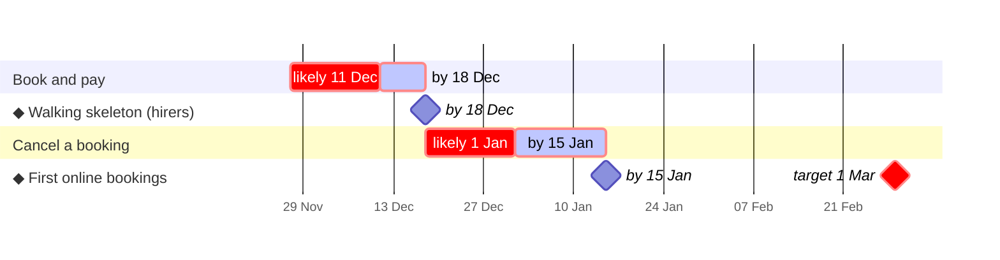

# HAL · Plan v1: Community hall bookings

Start: 2026-11-23 · Dates are Fridays. Likely: half the trials finished by then. Very likely: 85 in 100 did.

## At risk

Nothing at risk.

## Milestones

| Milestone | Target | Likely | Very likely | Chance of meeting the target |
| --- | --- | --- | --- | --- |
| `HAL-MIL-001` Walking skeleton (hirers) | none | 2026-12-11 | 2026-12-18 | no target |
| `HAL-MIL-002` First online bookings | 2027-03-01 | 2027-01-01 | 2027-01-15 | 100% |

## Chart

One row per Spec: dark to its likely finish, a light tail to its very likely finish, red when it is on the critical path. Specs are grouped by Milestone, groundwork first, and each group ends with its Milestone's row: a ◆ at its very likely date and a red ◆ at its target. Bars are worked out from Stories finished each week, not estimates.

## Specs with no date yet

Every Spec has a date.
