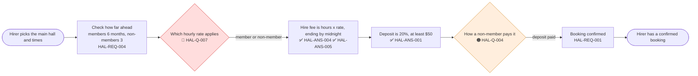

# HAL-EPC-001 Book and pay: your calls before we build

> Spec **HAL-EPC-001** · Initiative Community hall bookings · from Spec pack v2 · for Margaret Osei · 11 Nov 2026 · *Examples are made up to show what each answer changes.*

**Margaret, this takes about 10 minutes.** Engineers are already working on this Spec. There is **1 being built on a guess**, **2 calls only you can make**, and **2 Decisions to confirm**.

## 🔴 Being built on a guess right now

### Does a member pay the member rate when they book the hall for a non-member's event? `HAL-Q-007`

It decides which rate a member's booking is charged. **Engineers are building on a guess: the member rate for anything a member books.** **Needed before this Spec is built.**

- **Example** (made up to show what the answer changes, `HAL-Q-007`): a member books the main hall for a friend's party, 6 pm to midnight, 6 hours. At the member rate that is 6 x $30 = a $180 hire fee, and 20% is $36, so the deposit is the $50 minimum. At the non-member rate it is 6 x $45 = a $270 hire fee, and 20% is $54, so the deposit is $54. Neither is settled.

Reply with one: yes, the member rate; no, the non-member rate; or something else.

## 🟠 Your calls

| Open item | Why it matters | Needed by |
| --- | --- | --- |
| **Cash deposits:** can non-members pay the deposit in cash at the hall office? `HAL-Q-004` | some older non-member hirers have no card; online-only payment may shut them out | 15 Dec |
| **Meeting room:** will the new meeting room be booked through the same service when it opens? `HAL-Q-013` | the room opens in mid-2027, and adding it later could change every price table | 31 Jul |

- **Example** (made up to show what the answer changes, `HAL-Q-004`): a non-member books the main hall for 3 hours, so the hire fee is 3 x $45 = $135 and the deposit is the $50 minimum. If cash is allowed, they hand $50 to the caretaker on a weekday morning and the booking is confirmed. If not, they must pay the $50 by card online or they have no booking. Neither is settled.

Tom is handling 1 more (who sees a booking's details `HAL-Q-008`). You don't need to answer it.
Not yet put to anyone: a named responsible adult on the night `HAL-Q-010`. If this one is yours, say so.

## ✅ Did we get these right?

Tick each one you agree with. If you don't tick one, say why, and it becomes a new open item.

- [ ] **A booking can run until midnight, and no later.** `HAL-ANS-004` · Ravi Kumar, 11 Nov · decided during build
  - **Example** (made up to show what it settles, `HAL-ANS-004`): a member books 8 pm to midnight, 4 hours at $30 is a $120 hire fee, and the deposit is the $50 minimum. A request to run until 1 am is not accepted.
- [ ] **There is no cleaning fee: the hire fee covers cleaning.** `HAL-ANS-005` · your call, 11 Nov
  - **Example** (made up to show what it settles, `HAL-ANS-005`): a non-member books 3 hours at $45, so the hire fee is $135 and that is the whole price shown, with no cleaning fee added.

You agreed already: the deposit is 20% of the hire fee, minimum $50 `HAL-ANS-001` (10 Nov).

## ⚪ We think these don't matter here. Say so if they do.

- **Who else hears of a booking.** Nothing else needs to hear of a booking yet; the caretaker's list is its own Feature.
- **Speed, uptime and access.** The committee has set no speed, uptime or access needs beyond any booking form.
- **Bookings taken by phone today.** They stay as they are; nothing moves over.

## How it works

One picture of a booking from request to confirmation. 🔴 is a guess, 🟠 an open call, ✅ a settled Decision.

### From request to confirmed booking

## Also worth knowing

- The deposit set here is also what a hirer gets half of back when they cancel late (`HAL-ANS-003`, in the Cancel a booking Feature): the two must stay in step.
- **Not in this Spec:** the door code in the confirmation email (`HAL-REQ-008`).

