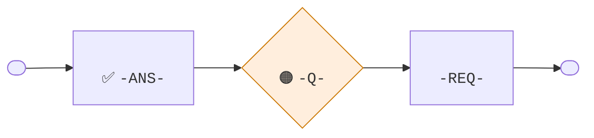

# <CODE>-EPC-<nnn> <Epic title>: your calls before we build

> {Epic} **<CODE>-EPC-<nnn>** · {Project} <Project name> · from {Epic pack} v<N> · for <Full name> · <D Mon YYYY> · *Examples are made up to show what each answer changes.*

**<First name>, this takes about <minutes> minutes.** <Only when handed off:> Engineers are already working on this {Epic}. There <is | are> **<g> being built on a guess**, **<c> <call | calls> only you can make**, and **<d> {Decision}<s> to confirm**.

## 🔴 Being built on a guess right now

### <The {Question}, as a plain question> `<CODE>-Q-<nnn>`

<Why it matters, in a sentence.> **Engineers are building on a guess: <the guess>.** **Needed <by D Mon | before this {Epic} is built>.** <Only when someone else is asked:> <Name> has been asked.

- **Example** (made up to show what the answer changes, `<CODE>-Q-<nnn>`): <who does what, in the Stakeholder's world, e.g. "A customer returns a $600 jacket on day 31".>
  - **Inputs:** <the inputs that matter, with numbers, e.g. "bought 31 days ago; $600; refund limit 30 days">.
  - **If <an answer, in a few words, e.g. "a manager approves">:** <the outcome the Stakeholder would see, worked through with the numbers.>
  - **If <the next answer>:** <its outcome.> <One sub-bullet per answer.>

Reply with one: <each option as a short phrase in your own words, separated by "; ", e.g. "a manager approves; any staff member can">; or something else.

<or> Nothing is being built on a guess.

## 🟠 Your calls

| {Question} | Why it matters | Needed by |
| --- | --- | --- |
| **<A short title in your own words, e.g. "Who approves big refunds">:** <the {Question}, as a plain question> `<CODE>-Q-<nnn>` | <why it matters, in a sentence> | <D Mon, "before this {Epic} is built", or "—"> |

- **Example** (made up to show what the answer changes, `<CODE>-Q-<nnn>`): <who does what, in the Stakeholder's world, e.g. "A customer returns a $600 jacket on day 31".>
  - **Inputs:** <the inputs that matter, with numbers, e.g. "bought 31 days ago; $600; refund limit 30 days">.
  - **If <an answer, in a few words, e.g. "a manager approves">:** <the outcome the Stakeholder would see, worked through with the numbers.>
  - **If <the next answer>:** <its outcome.> <One sub-bullet per answer.>

<Name> is handling <n> more (<a short title in your own words, e.g. "Who approves big refunds"> `<CODE>-Q-<nnn>`, …). You don't need to answer <it | them>.
Not yet put to anyone: <a short title in your own words, e.g. "Who approves big refunds"> `<CODE>-Q-<nnn>`, …. If one of these is yours, say so.

<or, with no row:> None of the open {Question}s here are yours to answer. <Then the two lines above, as they apply.>

## ✅ Did we get these right?

Tick each one you agree with. If you don't tick one, say why, and it becomes a new {Question}.

- [ ] **<The {Decision}, as a plain statement.>** `<CODE>-ANS-<nnn>` · <your call | Name>, <D Mon> <· decided during build>
  - **Example** (made up to show what it settles, `<CODE>-ANS-<nnn>`): <who does what, in the Stakeholder's world.>
    - **Inputs:** <the inputs that matter, with numbers.>
    - **Outcome:** <the outcome the Stakeholder would see under this {Decision}, worked through with the numbers.>

You agreed already: <a short title in your own words, e.g. "Managers approve big refunds"> `<CODE>-ANS-<nnn>` (<D Mon>); ….

<or, with no box:> Nothing new to confirm. <Then the "You agreed already" line, if any.>

## ⚪ We think these don't matter here. Say so if they do.

- **<What the category covers, in plain words>.** <The Operator's reason.>

<or> None: every part of this applies here.

## How it works

<One sentence on what the pictures show. 🔴 is a guess, 🟠 an open call, ✅ a settled {Decision}.>

### <What this part of the flow does>

<A lead sentence tying this diagram to its heading: which part of the flow it is, and why <First name> is looking at it, e.g. "This is what happens from the moment a hirer asks for a date until the booking is paid for; two of its steps still wait on you.">

- **<A step, as its node says>** (✅ `<CODE>-ANS-<nnn>`): <what happens here, and why it's there.>
- **<A choice, as its node says>** (🟠 `<CODE>-Q-<nnn>`): <what happens here, and why it's there.> <For a 🔴 or 🟠 node:> Still open: see _<the heading it sits under above, e.g. Your calls>_.
- **<A step, as its node says>** (`<CODE>-REQ-<nnn>`): <what happens here, and why it's there.>

## Also worth knowing

- <Each pain point that is no {Question} or {Decision} above, in one plain line.>
- **Not in this {Epic}:** <each Left out line, in plain words, with its ID.>
- **Needs first:** <each Depends on line, in plain words.>

<or> Nothing else.
